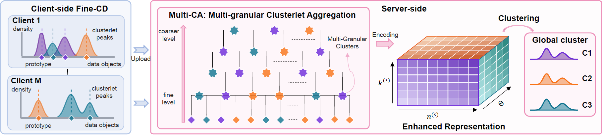

# FedHCA
One-Shot Hierarchical Federated Clustering for Distributed Non-IID Biomedical Data Analysis


## Project Structure

- `algorithm/MultiClustering.py`: Fine-CD, Multi-CA, and the FedHCA ensemble step.
- `algorithm/federatedClustering.py`: end-to-end federated clustering workflow.
- `algorithm/experiment.py`: optional clustering evaluation metrics.
- `dataset/`: prepared `.npz` datasets copied from the original experiments.
- `main.py`: command line entry point.

## Quick Start

```bash
python main.py --dataset US
```

Use another dataset by replacing `EC` with one of the files in `dataset/`, for
example:

```bash
python main.py --dataset CA --runs 3
```

## Dataset Format

Each `.npz` file stores one dictionary per client. A client dictionary is
expected to contain:

- `data`: local feature matrix.
- `label`: ground-truth labels, used only for evaluation and for setting the
  target number of global clusters in the current research implementation.
- `size`: number of local samples.


### Clustering Performance: Purity

| Index | Data | kFed | FFCM-1 | FFCM-2 | OSFSC | FedSC | NN-FC | AFCL | FedHCA |
|---|---|---|---|---|---|---|---|---|---|
| Purity | EC | *0.687±0.01* | 0.417±0.05 | 0.374±0.02 | 0.538±0.03 | 0.345±0.00 | 0.650±0.06 | 0.348±0.01 | **0.696±0.05** |
| Purity | US | 0.470±0.01 | 0.465±0.00 | 0.459±0.01 | 0.409±0.02 | 0.343±0.00 | *0.473±0.04* | 0.337±0.00 | **0.529±0.05** |
| Purity | VE | *0.380±0.02* | 0.342±0.00 | 0.343±0.00 | 0.362±0.01 | 0.347±0.01 | 0.368±0.02 | 0.298±0.00 | **0.406±0.02** |
| Purity | EP | 0.345±0.01 | 0.341±0.00 | 0.331±0.00 | **0.348±0.01** | 0.342±0.00 | 0.334±0.00 | 0.341±0.00 | *0.346±0.00* |
| Purity | YE | *0.447±0.05* | 0.294±0.00 | 0.289±0.00 | 0.406±0.02 | 0.283±0.00 | 0.358±0.04 | 0.281±0.01 | **0.493±0.06** |
| Purity | CA | *0.515±0.03* | 0.375±0.00 | 0.351±0.00 | 0.467±0.02 | 0.441±0.05 | 0.418±0.02 | 0.289±0.00 | **0.542±0.04** |
| Purity | LA | 0.610±0.01 | 0.613±0.00 | 0.475±0.00 | 0.612±0.00 | 0.622±0.01 | *0.669±0.05* | 0.283±0.11 | **0.752±0.01** |
| Purity | WI | 0.492±0.02 | **0.520±0.00** | 0.464±0.00 | 0.485±0.01 | 0.467±0.01 | 0.467±0.00 | 0.464±0.00 | *0.514±0.02* |
| Purity | PE | 0.632±0.00 | 0.335±0.00 | 0.311±0.00 | **0.664±0.02** | 0.519±0.04 | 0.655±0.03 | 0.162±0.00 | *0.662±0.06* |
| Purity | LE | 0.335±0.01 | 0.143±0.00 | 0.100±0.00 | 0.329±0.01 | 0.241±0.02 | *0.338±0.02* | 0.089±0.00 | **0.346±0.02** |
| $\overline{AR}(ST)$ | - | 3.0 (+) | 4.9 (+) | 6.6 (+) | 3.5 (+) | 5.3 (+) | 3.7 (+) | 7.7 (+) | 1.3 |
### Clustering Performance: ARI

| Index | Data | kFed | FFCM-1 | FFCM-2 | OSFSC | FedSC | NN-FC | AFCL | FedHCA |
|---|---|---|---|---|---|---|---|---|---|
| ARI | EC | *0.420±0.06* | 0.060±0.04 | 0.048±0.01 | 0.163±0.04 | -0.001±0.01 | 0.415±0.12 | 0.013±0.01 | **0.452±0.09** |
| ARI | US | *0.155±0.00* | 0.127±0.00 | 0.125±0.01 | 0.045±0.01 | 0.001±0.00 | 0.128±0.05 | 0.000±0.00 | **0.227±0.12** |
| ARI | VE | *0.079±0.00* | 0.048±0.00 | 0.049±0.00 | 0.037±0.00 | 0.061±0.00 | 0.056±0.02 | 0.000±0.00 | **0.088±0.02** |
| ARI | EP | *0.015±0.01* | 0.010±0.01 | **0.016±0.00** | 0.014±0.01 | 0.003±0.00 | 0.002±0.01 | 0.000±0.00 | 0.012±0.00 |
| ARI | YE | *0.198±0.06* | 0.045±0.00 | 0.044±0.00 | 0.088±0.01 | 0.003±0.00 | 0.097±0.04 | 0.003±0.01 | **0.217±0.06** |
| ARI | CA | *0.193±0.02* | 0.064±0.00 | 0.061±0.00 | 0.107±0.02 | 0.185±0.05 | 0.122±0.03 | 0.000±0.00 | **0.251±0.04** |
| ARI | LA | 0.383±0.02 | 0.372±0.00 | 0.219±0.00 | 0.315±0.01 | *0.483±0.03* | 0.452±0.05 | 0.041±0.13 | **0.539±0.05** |
| ARI | WI | 0.031±0.03 | *0.038±0.00* | -0.010±0.01 | 0.022±0.02 | 0.003±0.01 | -0.010±0.01 | 0.000±0.00 | **0.048±0.03** |
| ARI | PE | 0.457±0.00 | 0.137±0.00 | 0.153±0.01 | 0.426±0.04 | 0.368±0.04 | *0.511±0.03* | 0.000±0.00 | **0.516±0.07** |
| ARI | LE | *0.160±0.01* | 0.037±0.00 | 0.005±0.00 | 0.080±0.02 | 0.129±0.01 | 0.144±0.01 | 0.000±0.00 | **0.174±0.02** |
| $\overline{AR}(ST)$ | - | 2.4 (+) | 5.1 (+) | 5.7 (+) | 4.8 (+) | 5.0 (+) | 4.0 (+) | 7.7 (+) | 1.3 |
